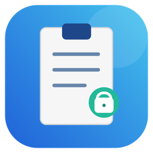
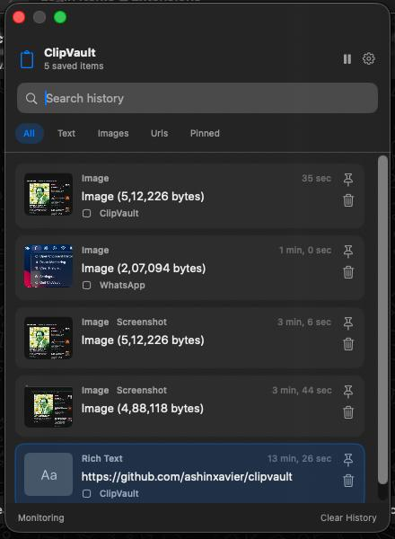
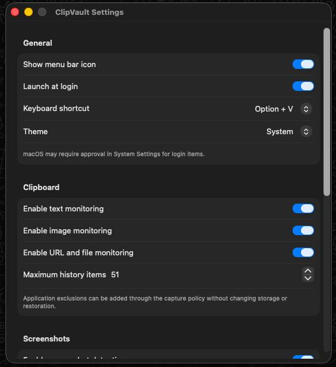
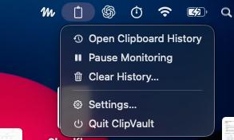

<div align="center">
  
  <h1>ClipVault</h1>
  <p>
    <strong>A local-first clipboard manager for macOS.</strong><br>
    Everything you copy, searchable from the menu bar.<br>
    No account. No sync. No analytics. No network.
  </p>
  <p>
    
    
    
  </p>
</div>

## Screenshots

<p align="center">
  
</p>
<p align="center">
  
</p>
<p align="center">
  
</p>

## Why ClipVault

- **Local-first by design.** Your history lives in `~/Library/Application Support/ClipVault` and nowhere else. ClipVault makes no network requests and never logs clipboard contents.
- **One keystroke away.** Press **Option + V** and a floating, keyboard-friendly panel appears. No Dock icon, no window clutter.
- **Remembers more than text.** Rich text, links, file references, images, and new screenshots, each with a preview and relative timestamp.
- **Yours to control.** Pause monitoring, toggle content types, cap history size, and clear anything or everything, pinned items included or not.

## Features

**Capture**
- Text, rich text, URLs, file references, and images, deduplicated by content so repeats don't pile up.
- Source-app metadata and previews where macOS provides them.
- Watches a screenshot folder, waits until each file has finished writing, and can copy new screenshots straight to the clipboard.

**Find and restore**
- Search plus All, Text, Images, URLs, and Pinned filters.
- Pin the items you reuse; pins survive routine cleanup.
- Restore the original content, not a flattened copy: rich text stays rich, files stay files, images stay images.
- Full keyboard control: arrows to move, Enter to restore, Escape to close, Command + F to search.

**Privacy and control**
- Pause and resume monitoring at any time, from the panel or the menu bar.
- Per-type switches for text, image, and URL/file capture.
- Adjustable history limit (500 by default, up to 5,000), storage usage view, and confirmed Clear Unpinned / Clear All actions.
- SQLite metadata plus file-based assets, stored with owner-only file permissions.

**Fits your Mac**
- Menu bar app with an optional icon, system/light/dark appearance, and launch at login.
- Configurable global shortcut: **Option + V** or **Control + Option + V**.

## Install

```sh
bash Scripts/package-dmg.sh
```

Open `build/ClipVault.dmg` and drag `ClipVault.app` to Applications.

The package is ad-hoc signed, not Developer ID signed or notarized, so macOS blocks it on first launch. After that first attempt, open **System Settings > Privacy & Security** and click **Open Anyway** to allow it.

## Usage

1. Launch ClipVault. Its clipboard icon appears in the menu bar.
2. Copy text, a link, a file, or an image as usual.
3. Press **Option + V** (or open history from the menu bar).
4. Search or filter, then select an item to restore it to the clipboard.
5. Open **Settings** to adjust capture, screenshots, storage, and privacy.

### Keyboard shortcuts

| Key | Action |
| --- | --- |
| **Option + V** | Open history (configurable) |
| **Up / Down** | Move selection |
| **Enter** | Restore selected item to the clipboard |
| **Escape** | Close the panel |
| **Command + F** | Focus search |
| **Delete** | Remove the selected item |

### Default settings

| Setting | Default |
| --- | --- |
| Shortcut | Option + V |
| History limit | 500 items |
| Screenshot folder | Desktop |
| Clipboard and screenshot monitoring | On |
| Screenshot auto-copy | On |
| Launch at login | On |

Settings are grouped into General, Clipboard, Screenshots, Storage, and Privacy.

## Your data stays on your Mac

ClipVault stores its database and assets locally:

```text
~/Library/Application Support/ClipVault/
```

SQLite holds history metadata; images and other binary content are stored as local files. The data directory and files get owner-only permissions, pinned items are retained during routine cleanup, and clipboard contents are never logged. Screenshot-folder access and launch at login are subject to standard macOS approvals.

## Build and test from source

**Requirements**

- macOS 14 or later
- Apple silicon (build scripts target `arm64`)
- Apple Command Line Tools with Swift 6.3.3
- The macOS 26.5 SDK at `/Library/Developer/CommandLineTools/SDKs/MacOSX26.5.sdk` by default; set `MACOS_SDK_PATH` to use another compatible SDK

**Commands**

```sh
bash Scripts/test.sh        # Run the 21-check core suite
bash Scripts/build.sh       # Build build/ClipVault.app
bash Scripts/package-dmg.sh # Build and package build/ClipVault.dmg
```

The scripts use `swiftc` directly; the Xcode GUI is not required, though an Xcode project is included for development.

The automated suite covers normalization, persistence, deduplication, monitoring, screenshot stability, and menu-state behavior. It does not exercise live pasteboard access, global shortcut delivery, login items, folder permissions, or the visible menu UI. For those, follow the [actual-Mac integration checklist](Tests/ClipVaultTests/MANUAL.md). A passing command-line suite is not verification of those macOS integrations.

## Troubleshooting

- **Shortcut doesn't open history:** another app may own it. Switch to **Control + Option + V** in Settings.
- **Screenshot folder unavailable:** reselect the folder in Settings and approve access if macOS asks.
- **Launch at login has no effect:** check ClipVault under **System Settings > General > Login Items**.
- **Build reports a missing SDK:** install the expected Command Line Tools SDK or point `MACOS_SDK_PATH` at a compatible one.

## Project layout

- `Sources/ClipVault/` - the app, UI, clipboard and screenshot monitors, and local persistence.
- `Tests/ClipVaultTests/CoreTestRunner.swift` - the offline regression suite.
- `Tests/ClipVaultTests/MANUAL.md` - real-Mac integration checks.
- `Scripts/` - build, test, and DMG packaging.

## License

[MIT](LICENSE)
